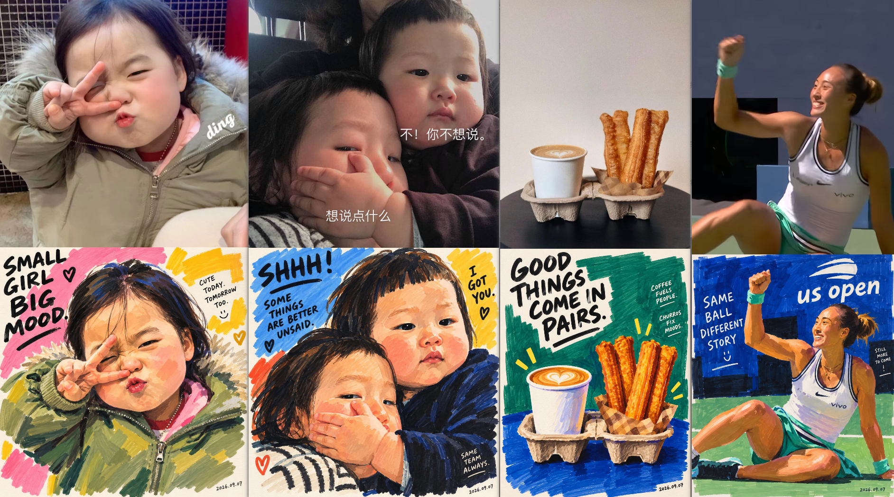
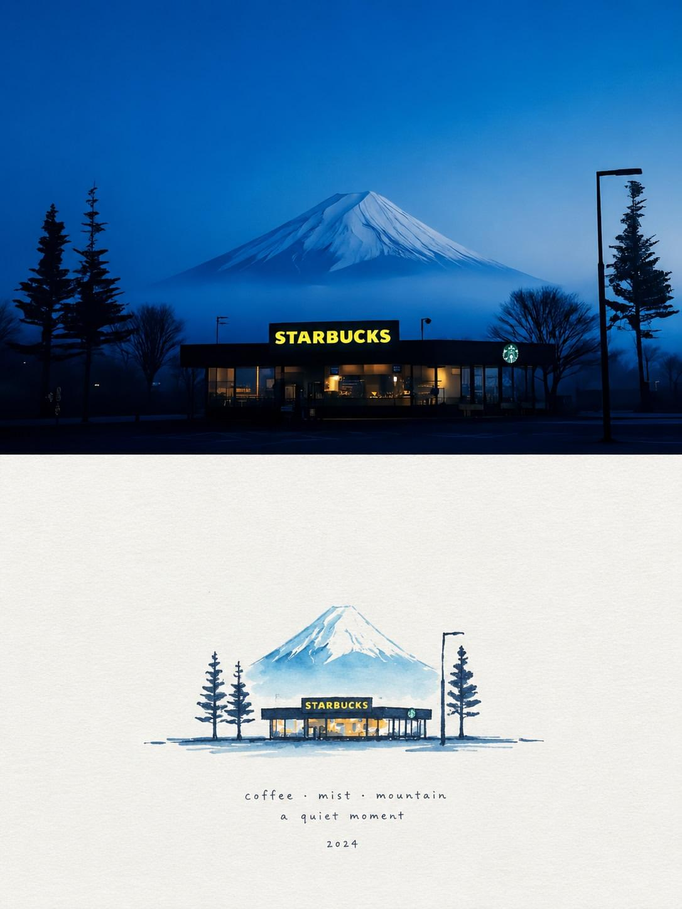
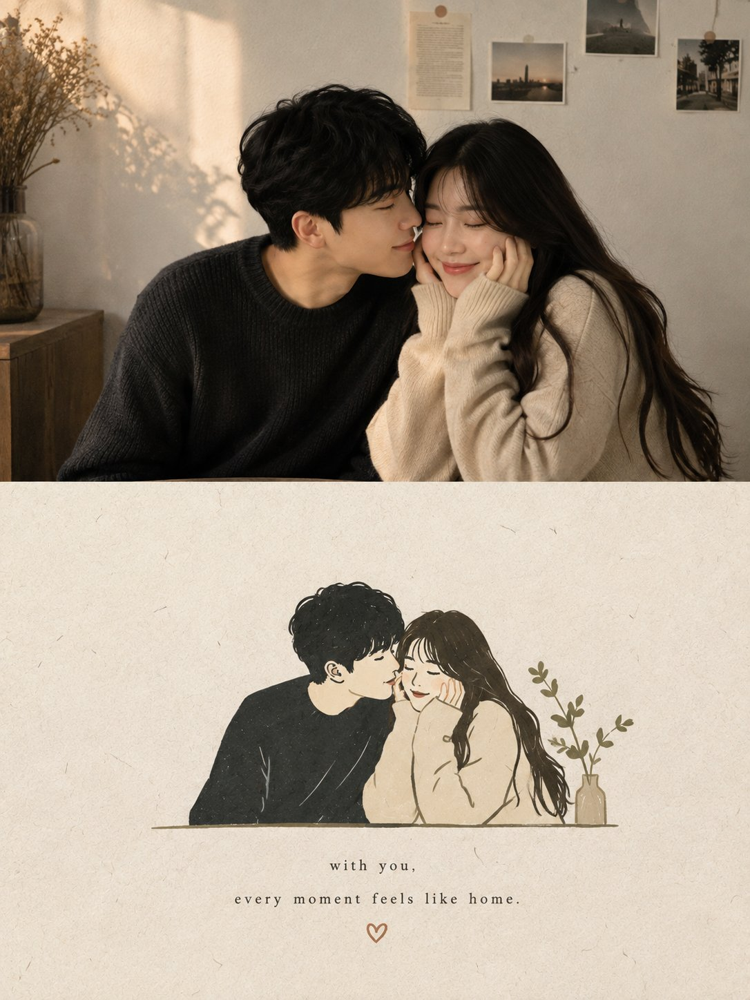
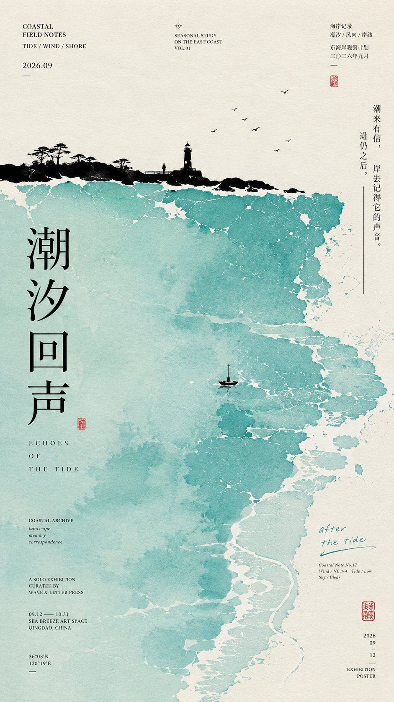

## Coding


### 标题规范化

```
请处理当前 Codex 中所有项目下的对话，仅修改对话名称，绝对不要修改项目名称。

规则：
- 日期取对话创建时间 `createdAt`，按 Asia/Shanghai 转换；不要使用 `updatedAt`。
- 格式统一为：`MMDD｜类型｜主题`
- 类型限定为：功能、设计、修复、优化、发布、探索、文档、研究。
- 主题根据对话实际内容提炼，不重复项目名称。
- 标题简洁、具体，适合左侧栏显示。
- 无法判断主题时不要猜，保留原名。
- 只修改对话标题，不修改项目名称、对话内容、项目归属、排序、置顶或归档状态。

Few-shot 示例：

原名称：优化批次文字显示
新名称：0903｜优化｜批次文字显示

原名称：整合快捷键提示页面
新名称：0902｜功能｜整合快捷键提示页

原名称：提交代码到 GitHub
新名称：0813｜发布｜提交代码到 GitHub

原名称：新功能讨论
新名称：0901｜设计｜界面对齐检查

执行前仅输出一个两列表格，表头严格为：

| 原名称 | 新名称 |

确认后再修改；修改完成后仅报告修改结果。
```


## 绘图


### 浓色马克笔人物画


<details>
<summary>点击展开查看完整内容</summary>
浓色马克笔人物画｜把一个真实的人，画成一件有趣的作品

创作任务

以用户上传的照片为唯一人物参考，创作一幅具有当代艺术感的马克笔人物画。

保留照片中人物的身份、神态、姿势和辨识度，但彻底重新组织颜色、笔触和画面空间。不是给照片套上绘画滤镜，而是像一位有观察力、有幽默感的画家，看过这个人之后，用几支颜色浓郁的宽头马克笔，把这个瞬间重新画出来。

画面应当大胆、浓厚、松弛，有鲜明的手工痕迹。第一眼被大色块吸引，第二眼认出照片中的人，第三眼发现旁边那句有点好笑的手写文字。

一、艺术方向

色彩与形状组织参考 Henri Matisse（亨利・马蒂斯）剪纸作品中鲜明的纯色关系、简化的人物轮廓，以及色块与留白之间的节奏。把这些启发转译为马克笔绘画，而不是制作剪纸拼贴。(泰特艺术馆)

文字与幽默参考 David Shrigley（大卫・史瑞格里）作品中简练的绘画、手写短句，以及对日常生活荒诞之处的观察。只借鉴这种图文之间的幽默关系；本次创作应更温暖，不沿用黑暗、尖刻的语气，也不复制他的具体作品或句子。(NGV)

统一成一种明确的视觉语言：浓色、宽笔、简化造型、真实神态、少量手写旁注。

不要机械混合多种画风。人物不是某位艺术家的固定角色，必须仍然是照片里的那个人。

二、先认出这个人，再简化这个人

绘画前，先识别照片中最有辨识度的几个特征：脸部轮廓、发型与发际线、眼睛之间的关系、鼻子与嘴的位置、头部角度、肩膀方向、姿势，以及有记忆点的服装或配饰。

围绕这些特征组织画面，而不是平均描绘所有细节。

保留人物原本的年龄感、肤色深浅关系、性别呈现与身体特征。保留明显的痣、雀斑、眼镜、胡须，以及帮助辨认身份的少量面部线条。

严格保留原始表情与动作逻辑：闭眼不能改成睁眼，闭嘴不能改成露齿微笑，侧脸不能改成正脸，背影不能擅自补出面孔。头发朝哪个方向散开，身体朝哪里倾斜，都应延续原图。

可以简化解剖细节，但不能通过美化、瘦脸、放大双眼、缩小鼻子，把人物重塑成另一张脸。

幽默主要来自文字和观察，不靠把人物画丑。

三、媒介：浓厚的不透明颜料马克笔

将绘画媒介设定为不透明颜料马克笔，偏丙烯马克笔质感，以宽扁笔头铺色，以中等笔头建立形状，最后用少量细笔完成必要细节和文字。

大色块应饱满、扎实、具有覆盖感，但不要出现油画颜料般的立体堆积。

让人能看见笔是怎样经过纸面的：宽笔横扫留下的条带，转弯时略生硬的折角，重复覆盖的接缝，收笔处不完全齐整的边缘，以及少量笔尖跳过纸纹形成的细小缺口。

大部分色面保持完整，只在局部露出这些痕迹。不要用遍布全图的颗粒噪点代替真实笔触。

先画色块，再补少量线条。不要先用均匀黑线勾出全部轮廓，再像填色本一样填满。

允许局部覆盖、轻微错位和不完全闭合的边界。保留画过的过程，不把每一笔修得完美。

四、用大色块建立人物

把头发、脸、颈部、上衣、手臂和必要配饰，概括成少数几块有重量的形状。形状之间的关系比细碎纹理更重要。

脸部主要由一个基础肤色色面、两三处结构性色块和少量五官笔画构成。取消毛孔、照片微纹理、细碎反光和复杂明暗渐变，但保留支撑身份辨识的面部结构。

眼睛用少量短笔和深色色点完成，眼神方向必须准确。不要统一画成大圆眼，不添加夸张的高光和睫毛。

眉毛用有粗细变化的短笔画出，保留原本的走向和距离。

鼻子可以主要由一块暖色与一两笔暗色提示，不进行精密的立体塑形。

嘴部保留原始开合状态、嘴角方向与情绪。只有原图确实露出牙齿时才画牙齿，并将其概括为简单形状。

头发先画整体轮廓，再添加少量能说明方向的笔画。深色头发可使用深褐、墨蓝或近黑的色块；浅色、灰白色头发保留其辨识度，不一律改成棕发。重要的碎发可以像突然划出的细线，松动人物边缘。

衣服保留款式、领口、层次和关键色彩关系。褶皱只留下解释姿势所必需的几笔。

手势是照片重点时，必须保留动作；手不是重点时，可以减少细节，但不能随意改变位置。

五、色彩：浓重，不沉闷；鲜明，不嘈杂

放弃原提示词中统一的浅粉彩、奶油肤色和淡蓝背景设定。

根据照片里的服装、肤色和情绪，选择一组有限而有力度的配色。通常使用四至六种主要颜色，以一种主导色建立整体气氛，一种对照色制造张力，再用少量强调色点亮画面。

候选色包括钴蓝、群青、朱红、番茄红、赭黄、深草绿、孔雀绿、茄紫、酒红和暖象牙白。每张画只选择适合它的几种，不要把所有颜色同时放进去。

让大面积颜色真正参与构图，而不是只把背景涂得鲜艳、人物仍然保留照片式写实。

肤色允许艺术化转译，可使用赭石、陶土、杏桃或暖棕等色面，并在局部引入与背景呼应的冷色。保留原人物肤色的深浅特征，不统一漂白，也不要把脸切成杂乱的彩虹碎片。

用相邻色块的冷暖与明度差建立体积，不依赖柔焦渐变、喷枪阴影或电影光效。

六、构图与背景

根据原图提取主要人物，删除无关路人、杂物和复杂环境。若是没有明显主次的合影，保留核心人物之间的关系，不任意删掉其中一人。

默认延续原图的横竖方向与关键动作。可以适度裁切、放大和调整主体位置，但不要把有意义的全身动作一律裁成头像。

采用松弛而准确的构图。人物可以略微偏向一侧，为文字留出自然的位置；不要为了对称而机械居中。

背景以一整块主色或两块大的颜色区域构成，可以保留少量暖白纸面。用色块边缘、人物轮廓与空白之间的关系创造空间，不还原完整的摄影环境。

只有当某个物件直接构成照片的趣味或人物特征时，才保留它，例如手中的杯子、被风吹起的帽子、怀里的宠物。把它同样画成简洁色块。

不要无意义地添加植物、星星、爱心、贴纸或几何装饰。画面需要的是取舍，不是堆满设计元素。

七、手写文字：像画家看着这个人，忍不住写了一句

先理解照片中真实可见的动作、表情、衣物或物件，再创作与之对应的幽默短句。

文字应当让人觉得：“这句话是看过这张照片才想到的。”

采用轻微反差、一本正经的玩笑、拟人化的小抱怨，或日常生活中的微小荒诞。不要直接说明照片里有什么，也不要使用励志鸡汤和与画面无关的流行口号。

英文为主，可酌情加入一句更短的中文；不必逐句双语翻译。主句控制在三至八个英文单词，另可添加一个一至三个单词的小旁注。除日期外，文字最多形成两组。

以下仅示范幽默机制，不是固定文案，不要全部写入画面：

头发明显凌乱时，可以写：
“MY HAIR HAS OTHER PLANS.”
人物认真拿着一小杯饮料时，可以写：
“SMALL CUP. BIG RESPONSIBILITIES.”

人物明显望向远处、呈放空姿态时，可以写：
“CURRENTLY BETWEEN THOUGHTS.”
必须根据实际照片重新判断和创作。没有对应的画面线索就不要使用这些句子，也不要为配合句子给人物添加道具。

幽默针对情境，不贬损人物外貌或身份。照片气氛庄重时，让文字更轻、更含蓄，不强行制造笑点。
文字必须像手写：笔画有压力变化，字母略有大小差异，基线轻微起伏，间距自然不均匀，但拼写正确、清晰可读。

使用深色笔写在浅色区域，或用暖白色颜料笔写在深色区域。文字与人物共享同一种手工质感，不像后期叠加的电脑字体。

可以有一条短短的手绘下划线，或一根确有指向作用的小箭头。不要变成满页涂鸦。

八、时间戳落款

完成绘画与旁注后，在画面右下角或下方留白处，以更小、更轻的手写字落下实际创作日期。

日期采用 http://YYYY.MM.DD 格式；能够确认具体时间时，可采用 http://YYYY.MM.DD · HH:mm 格式。

使用生成作品时可核实的日期与时间，优先遵循用户指定的时区。无法确认时分时，只写日期，不编造精确时间。不要把生成日期冒充照片拍摄日期，也不要把格式占位符直接画进作品。

落款像画家画完后随手留下的一笔，与主文案拉开层级。不添加虚构的艺术家签名、品牌标志或水印。

九、最终控制

避免写实照片质感、半写实 AI 油画、柔软喷枪渐变、透明水彩晕染、粉彩糖果色、塑料皮肤、动漫大眼、三维卡通、矢量轮廓、满画面黑色描边，以及过度精细的头发和织物纹理。

也避免另一种极端：不要把 “艺术感” 理解成随意破坏五官，把 “手工感” 理解成脏乱，把 “幽默” 理解成堆砌段子。

最终画面应当像一幅可以挂在小型画廊里的马克笔人物作品：远看，色块鲜明而有秩序；近看，笔触有停顿、有覆盖、有人的手感；再看，人物仍然是照片里的那个人，而旁边的一句小字，让整个瞬间突然有了性格。

少画一些无关细节，把颜色画得更有分量，把人画得更像他自己。
</details>





### 水彩艺术印刷品

<details>
<summary>点击展开查看完整内容</summary>


使用上传的图像作为确切的构图和主题参考。将原始夜间照片转化为精致的 handmade 水彩艺术印刷品，同时保留可辨识的场景和所有主要元素。

在前景中央重现星巴克咖啡馆，包括其深色低调建筑、清晰可见的 STARBUCKS 标志、发光的温暖室内灯光、户外座位/窗户、周围常绿树木、简约街灯，以及直接矗立在咖啡馆后面的雄伟雪覆盖的富士山。保留原始视角、比例、位置和大气深度。

风格：传统日本风格水彩插图，绘制在温暖的象牙色纹理纸上，优雅而简约，采用柔和的透明水洗、微妙的颜料晕染、可见的纸张纹理、松散的手绘笔触，以及自然的不完美水彩边缘。

使用克制的冬季调色板，包括深钴蓝色、冰蓝色、柔和青色、低调海军蓝、浅灰色，以及来自咖啡馆窗户和标志的温暖金黄色。用精致的蓝灰色雪影描绘富士山，并在山脚下环绕大气薄雾。将天空美妙地简化成平滑的水彩渐变，而不是摄影细节。

创作一幅高级简约文具/画廊艺术印刷构图，插图相对较小且居中，周围环绕着宽敞的空白奶油色纸张。

在插图下方，添加整齐的手写风格排版，精确阅读：

“咖啡 · 薄雾 · 山”
“宁静一刻”

然后在其下方：

“2024”

排版应小巧、低调，使用深蓝灰色墨水，带有真实的手写不完美感。

重要：保持星巴克品牌和标志清晰可辨，保留富士山的独特形状，不要添加人物、汽车、额外建筑或不必要物体。无摄影真实感，无数字 3D 效果，无粗重轮廓，无过饱和颜色。最终结果应感觉像一幅手工制作的宁静、精致的日本水彩旅行印刷品。

</details>





### 书籍封面海报

<details>
<summary>点击展开查看完整内容</summary>

为每张上传的照片创建一张独立的高端编辑海报，切勿将它们组合在一起。

格式：严格的 3:4 纵向比例，分为两个相等的 50/50 水平部分。

顶部：忠实保留原始照片的身份、姿势、比例、服装、物体、构图、照明和颜色。只施加微妙的高端编辑调色；如有需要，进行无缝背景扩展。

底部：将照片重新诠释为极简的手工纸质插图。保留可识别的主体、轮廓、姿势和关键物体，但大幅简化。小型居中插图（10–20%）伴随大量留白，粗糙的温暖/米白色纸张，精致的不完美线条，大胆的扁平丙烯酸状形状，手工笔触痕迹和微妙的纸张纹理。

使用最多 4 种颜色，从原始照片中提取。仅在自然契合时使用极简低调的字体。

整体感觉：宁静、诗意、精致、极简、艺术性、高端独立艺术书籍封面风格。

避免卡通、水彩、蜡笔、彩色铅笔、3D、光泽数字艺术、插图中的写实风格、繁忙布局以及过多文字。

</details>





### 中式极简艺术展览海报

<details>
<summary>点击展开查看完整内容</summary>

【主题】：{填写}
【主色域】：{填写}
【地景】：{填写}
【微型叙事】：{填写}
【中文题跋】：{填写}
【画幅】：9:16

生成一张高完成度的中式极简艺术展览海报，融合东方山水留白、现代 Editorial Design、抽象色域绘画和纸本艺术。

以干净暖象牙白艺术纸为背景，用一块占画面约 40%–55% 的不规则【主色域】建立情绪。色块具有细腻矿物颜料、水粉、丝网印刷与纸张渗透质感，边缘自然、内部有轻微水痕和浓淡变化，但保持干净，不做脏旧纹理。

在色域与留白之间加入一条极薄的墨黑【地景】，可使用海岸、山脊、森林、长堤、建筑等远景轮廓。加入非常小的【微型叙事】，通过 “大色域 × 微地景 × 小人物/小建筑” 形成尺度反差和故事感。

中文主标题使用高瘦宋体或现代明朝体，优先纵向排版；搭配小号英文 Serif、日期、FIELD NOTES 等微型编辑信息，并加入【中文题跋】、少量手写笔记和一枚极小朱砂红印。

保持 “大结构简洁、微细节丰富”：远看极简，近看有层次。不同主题要重新设计色域走势、地景结构和叙事内容，不要只换颜色和标题。

避免：简陋空白、粗糙平涂、模板换色、巨大黑山、旅游插画、过度古风、脏污做旧、随机裂纹、AI 乱码、UI、Logo、水印、编号、四角星芒和 Sparkle。

</details>





### 写真经验

```
很多人做 AIGC 写真，提示词写了几百字，最后出来的 10 张图却像摄影师钉在地上没动过。

这组系列图让我更确定一件事：真正拉开系列感的，不是换场景，而是换 “摄影机的位置”。

比如这种海港放课后写真，我不会只写「俯拍 / 仰拍 / 广角」这么简单，而是把机位拆成：

摄影机在哪里 + 比人物高还是低 + 离人物多远 + 从哪个方向拍 + 前景是什么 + 人物在画面里有多大。

于是就能写成：

「摄影机站在楼梯最上方，向下俯拍，人物只占画面 15%，楼梯和栏杆形成纵深」

「摄影机贴近地面，距离人物约 1 米，24mm 广角，鞋和自行车轮进入前景，人物从画面上方经过」

「摄影机位于人物侧后方 2–3 米跟拍，人物不看镜头，海面和栏杆保持可辨认」

「摄影机贴近人物肩侧，35mm 近景，透明泡泡靠近镜头，手部轻微失焦，脸在第二景深层」

机位不是 “高低” 两个字，而是摄影机和人物之间的空间关系。

再配合这组图里的冷蓝绿调、细胶片颗粒、轻微高光溢出和人物柔焦美颜，哪怕服装完全不换，也能拍出一整套真正有节奏的写真。

我现在写系列图，基本都遵循一个公式：

机位位置 × 相机高度 × 拍摄距离 × 拍摄方向 × 景别 × 前景关系 × 人物位置

把这 7 个变量真正随机起来，比堆 50 个 “电影感、氛围感、高级感” 有效得多。
```

